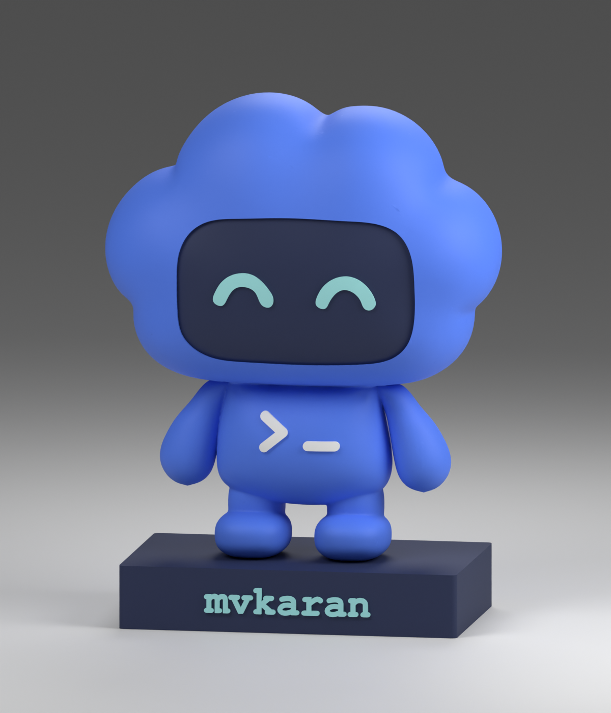
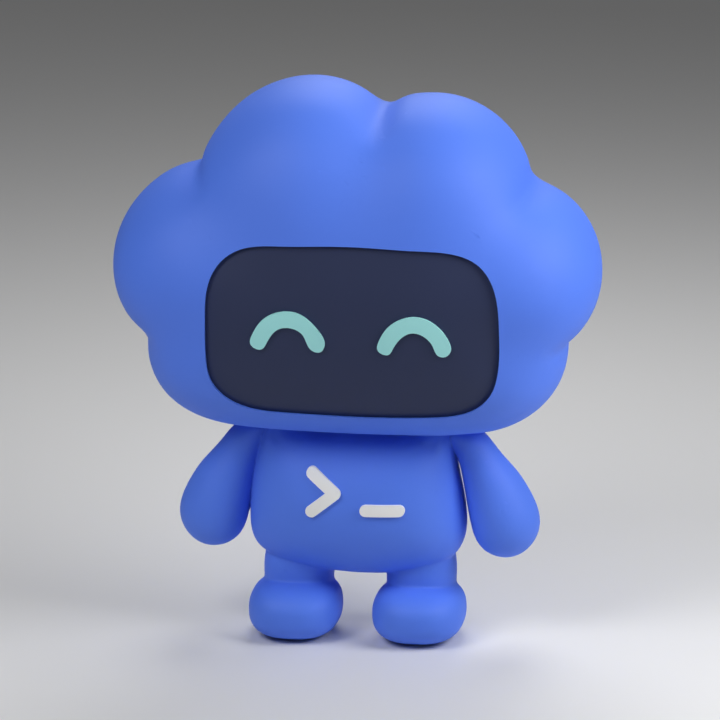
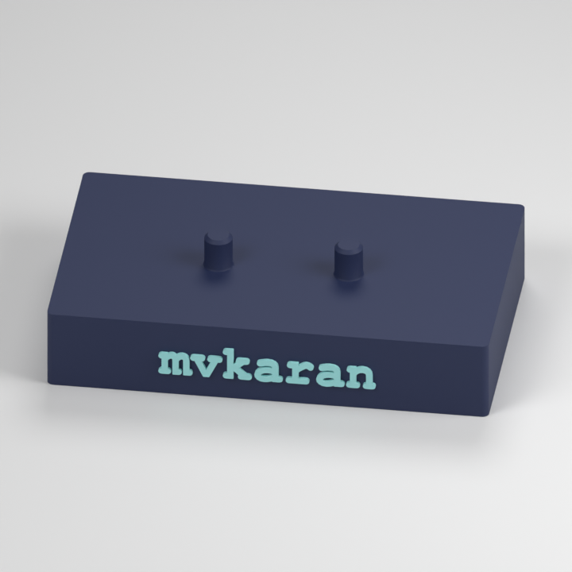
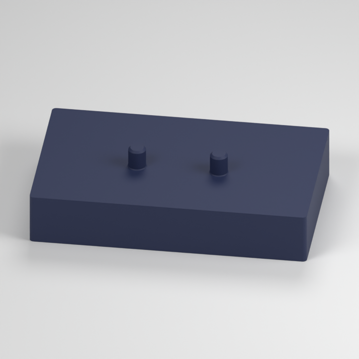

# Codex pet figurine

A four-color Codex pet figurine with a removable base, made for the Bambu Lab P1S with AMS. Choose a plain base or one with `mvkaran` on the front.

## Downloads

Download individual files below or get the [complete v2.1 package](https://github.com/mvkaran/codex-pet-figurine/releases/tag/v2.1).

| Model | Render preview | Blender file | 3MF files |
| --- | --- | --- | --- |
| **Figurine** — four colors, upright |  | [Figurine.blend](modeling/01-figurine.blend) | [Bambu P1S print project](print-projects/01-figurine-upright-P1S.3mf) [Geometry only](geometry/figurine.3mf) |
| **Named base** — `mvkaran`, two colors |  | [Named-base.blend](modeling/02-base-mvkaran.blend) | [Bambu P1S print project](print-projects/02-base-mvkaran-P1S.3mf) [Geometry only](geometry/base-mvkaran.3mf) |
| **Plain base** — no name, one color |  | [Plain-base.blend](modeling/03-base-plain.blend) | [Bambu P1S print project](print-projects/03-base-plain-P1S.3mf) [Geometry only](geometry/base-plain.3mf) |

*Images are renders; printed colors and finish will vary.*

Print the figurine upright and your chosen base flat, as saved in the Bambu projects. Open each 3MF as a project and reslice for your printer and filaments. The figurine and base use different print settings, so keep them as separate jobs.

The Blender files in the table contain individual pieces. Full assembled scenes are available with the [named base](modeling/Codex-pet-v2.blend) and [plain base](modeling/Codex-pet-v2-plain-base.blend).

## Size

- Figurine: **90.65 × 44.09 × 105.70 mm** (width × depth × height).
- Base: **78 × 47 mm** footprint.
- Assembled height: **120.20 mm**.

## Printing

**Print settings and instructions are in [PRINTING.md](docs/PRINTING.md).**

The figurine and named base were printed on a **P1S with a 0.4 mm nozzle, textured PEI plate and AMS**. The plain base has been sliced but not yet printed.

The figurine uses 0.16 mm layers, finer layers around the crown, three walls and 5% infill. Both bases use five walls and 60% infill for weight and stability. Supports are included for the figurine; the bases need none.

| AMS slot | Filament | Used for |
| --- | --- | --- |
| A1 | ELEGOO Blue PLA, Generic PLA profile | Cloud head, body, arms and feet |
| A2 | Bambu Lab PLA Matte Dark Blue | Face panel, base and pegs |
| A3 | Bambu Lab PLA Matte Ice Blue | Eyes and base lettering |
| A4 | Bambu Lab PLA Matte Ivory White | Terminal prompt on chest |

Check the filament profiles and AMS mapping before printing. The plain base uses Dark Blue only.

| Part | Estimated time | Filament, including supports and purging |
| --- | --- | --- |
| Figurine | 15 h 33 min | 237.67 g |
| Named base | 4 h 51 min | 71.98 g |
| Plain base | 3 h 27 min | 46.94 g |

See the [Blender guide](modeling/README.md) for editing.

## Fit

Both bases have 5.00 mm pegs, spaced 23 mm apart. The fit is slightly loose.

The figurine has one round socket and one elongated, tapered socket, so the two sides can feel different. Hold the base when carrying the assembled model. Socket dimensions are in the [print guide](docs/PRINTING.md#joint-and-assembly).

## Attribution

An unofficial fan project inspired by the Codex pet on [OpenAI Developers](https://developers.openai.com/), with no affiliation or endorsement from OpenAI. No license has been selected. See [ATTRIBUTION.md](ATTRIBUTION.md).
